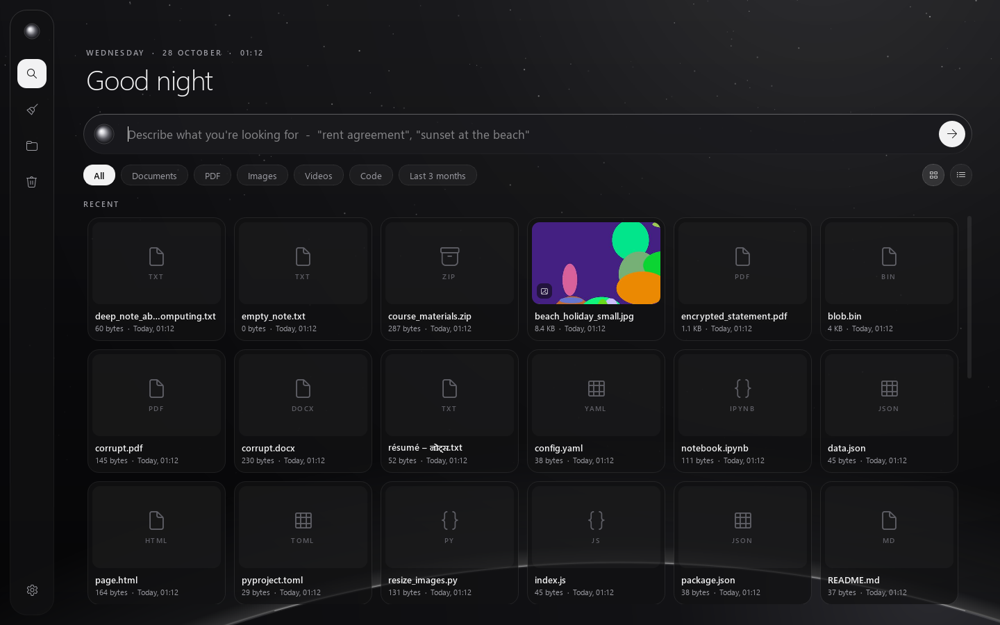
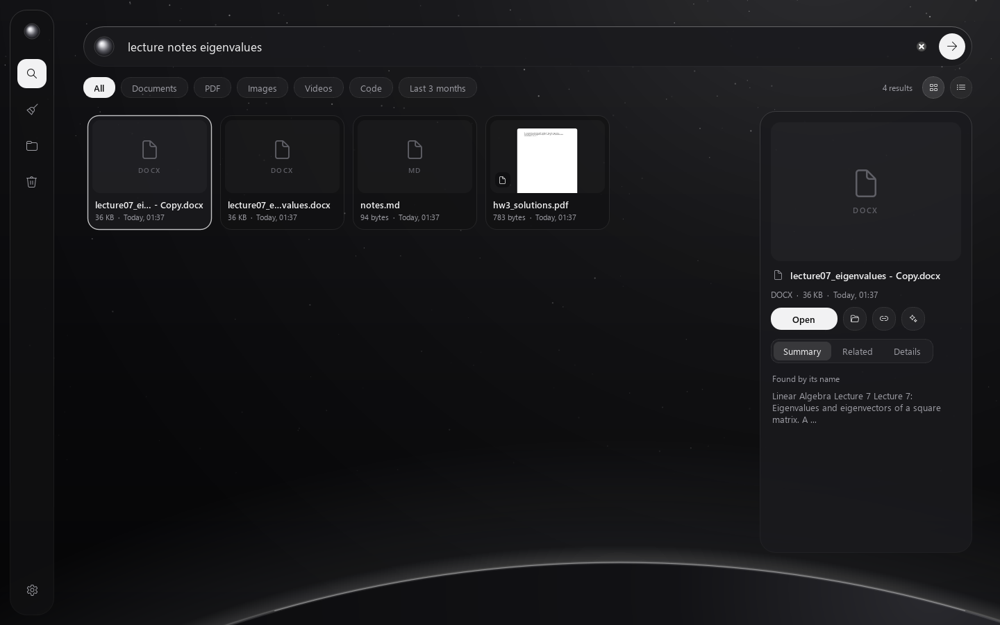
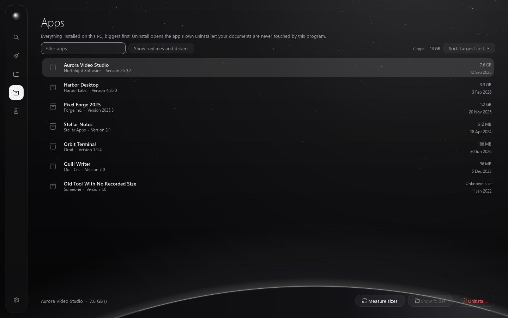
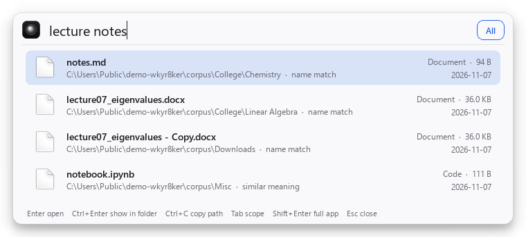

# Local File Intelligence

A private, local-first Windows desktop app that indexes the folders you choose, lets you find
files by meaning, finds exact and near-duplicates, explains cleanup suggestions, proposes a
better folder structure, and makes approved changes safely: quarantine instead of delete,
journaled and reversible, and verified before every move.

No cloud, no telemetry. After a one-time model download, everything works offline.

## What it does

| Feature | How |
|---|---|
| Index selected folders (read-only, incremental, resumable, cancellable) | `scandir` walk, isolated parser processes, BLAKE3 hashes, SQLite |
| Text from PDF, DOCX, PPTX, XLSX, CSV, TXT/MD, JSON/HTML/XML, code, notebooks, ODF, EPUB; ZIP listings; image EXIF and size | pypdfium2, python-docx, python-pptx, openpyxl, Pillow, stdlib |
| Natural-language + keyword search, filters (`ext:pdf kind:image after:2024 larger:10MB in:Downloads`), related files | ONNX embeddings (fastembed) + SQLite FTS5, fused with Reciprocal Rank Fusion |
| **Find images by describing them** ("the receipt from the grocery store", "screenshot of some code", "sunset at the beach"), even when they are named `IMG_0042.jpg`; conservative auto-tags | Local vision-language model nomic-embed-vision/text v1.5 int8 (~230 MB, Apache-2.0) in a low-priority isolated worker |
| Exact duplicates (hard-link aware), near-duplicate images, similar documents | BLAKE3; pHash + dHash with multi-index hashing; embedding similarity + text overlap |
| Cleanup baskets with an explainable 0-100 **review-priority score** | Named signals with evidence and points; weights configurable; learns from your decisions |
| Reclaimable space without double counting | Unique physical files (volume + file ID) across baskets |
| Organization suggestions with editable groups and destination preview | Categories (rules + zero-shot + learned), clustering, c-TF-IDF labels, collision-safe paths |
| Quarantine, restore, undo, Recycle Bin, permanent delete (separately confirmed) | Write-ahead journal, same-volume atomic moves, manifest, crash recovery |
| **Quick search** launcher: press **Alt+Shift+Space** anywhere, type, Enter opens | Small always-on-top window + tray icon in the style of Flow Launcher (see below) |

## The app



A quiet, monochrome window: deep blacks (or soft whites in the light variant), frosted panels over
a starfield with a planet's rim along the bottom, and four places in a floating rail on the left -
five places, nothing else to learn. Hover a symbol in the rail to see its name; a ring turns there while the
index is being updated.




| Place | What you do there |
|---|---|
| **Search** | Type what you remember ("rent agreement", "sunset at the beach"). Narrow it with the chips: All, Documents, PDF, Images, Videos, Code, and *Last 3 months*. Results are cards with real previews - photos, the first page of PDFs, the thumbnail Office files carry - or a compact list (buttons on the right). The panel on the right shows the file with **Open**, **Show in folder**, **Copy location** and **Find similar**, and three tabs: *Summary* (the text it was found by), *Related* (similar files) and *Details*. With nothing typed, it greets you and lists your recent files. |
| **Clean Up** | One number - how much can be freed right away - and a few categories, ranked by the space each would free; inside one, the biggest files come first (duplicates, temporary and empty files are pre-selected; similar photos, old installers and large files are for review). **Remove** moves files to Recently Removed, with **Undo**. |
| **Organize** | Suggested folders for loose files. Turn off any you don't want, then **Tidy Up**, with **Undo**. |
| **Apps** | Everything installed on this PC (classic apps and Microsoft Store apps), biggest first, with a filter box. **Uninstall...** asks first and then opens *the app's own uninstaller* (it asks Windows for permission itself if it needs it; this program never runs as administrator and never deletes an app's files). Runtimes and drivers that other programs may need are hidden unless you ask for them. Installers sometimes record a wrong size, so **Measure sizes** adds up the real folder sizes (nothing is opened or changed). |
| **Recently Removed** | Everything you removed: **Restore**, or move to the Recycle Bin. |

**Ranking by size, everywhere.** Every list has a **Sort** pill: Search (best match, newest, *largest first*, smallest, name - with nothing typed it ranks your whole library, so *Largest first* shows the biggest files you have), Clean Up categories, Organize folders, Apps and Recently Removed. To get rid of a big file you find in Search, select it and press **Remove** (or the Delete key): it moves to Recently Removed with **Undo**, never straight to deletion.



**Keys:** `Ctrl+1` to `Ctrl+5` switch place, `Ctrl+F` / `Ctrl+K` jump to the search box, `Ctrl+,` opens Settings, `Esc` clears the search box (then closes the preview), `Delete` removes the chosen file in Search, arrow keys move through results, `Enter` opens.

The first start asks which folders to look after (Desktop, Documents, Downloads, Pictures are
offered) and, if needed, whether to download the smart-search models (about 300 MB, once). After
that the app keeps itself up to date - there is no "index" button. **Settings** (the gear at the bottom of the rail):
folders, keep up to date, the quick search shortcut, appearance (light/dark/automatic), using the
graphics card, and **Advanced tools**.

**Advanced tools** is the original, detailed window: every duplicate type, review-priority scores
with their evidence, editing organization plans, indexing details and problem files, the activity
history with undo, permanent deletion, and all settings. Open it from Settings, with
`startup.bat` option 3, or with `LocalFileIntelligence.exe --advanced` /
`python -m lfi.ui.app --advanced`.

## Quick search (launcher)



A small search bar for everyday use, in the spirit of Flow Launcher. Start it once
(`scripts\run.ps1 -Quick`, Settings → *Quick search* → *Start quick search now*, or
`LocalFileIntelligence.exe --quick`); it then lives in the system tray.

| Key | Action |
|---|---|
| **Alt+Shift+Space** (anywhere) | brings the app forward on Search, ready to type (Settings can make it open the small bar instead) |
| type | results update as you type: documents, photos, screenshots, by name, content or description |
| Up / Down, PgUp / PgDn | choose a result |
| **Enter** | open the file |
| **Ctrl+Enter** | show it in File Explorer |
| **Ctrl+C** | copy the full path |
| **Tab** | switch All → Documents → Images |
| **Shift+Enter** | open the full app (add folders, organize, clean up) |
| **Esc** | hide |

* Keyword results appear instantly; the search models load on the first search and are released
  after 10 idle minutes (Settings), so the tray process stays small when you are not searching.
* If the shortcut is already taken by another program, the default falls back to
  Win+Alt+Space, Ctrl+Alt+K or Win+Shift+F, and the tray tooltip shows which one is active.
* *Start quick search when I sign in to Windows* (Settings, off by default) adds a normal shortcut
  to your Startup folder; untick it to remove the shortcut again.
* It only reads the index. Folders are added and indexed in the full app.
* The shortcut works while the small helper runs in the tray; opening the app starts it, and
  *Open at sign-in* starts it with Windows.

## Quick start (Windows 11, PowerShell)

Prerequisites: [uv](https://docs.astral.sh/uv/) (`winget install astral-sh.uv`). uv installs a
matching Python 3.12 automatically. Without uv, the setup script falls back to `py -3.12` + pip.

```powershell
git clone <this repo> ; cd file_sorter
powershell -ExecutionPolicy Bypass -File scripts\setup.ps1        # CPU; downloads the document (67 MB) and image (230 MB) models
powershell -ExecutionPolicy Bypass -File scripts\setup.ps1 -Gpu   # or: GPU via DirectML (any DX12 GPU)
powershell -ExecutionPolicy Bypass -File scripts\run.ps1          # start the app
```

Or simply double-click **`startup.bat`**. On first start, pick the folders to look after and click
**Get Started**; indexing runs by itself and search works while it does. Try it safely first on a
synthetic demo folder (then add it in Settings → Add Folder):

```powershell
.venv\Scripts\python -m lfi.cli demo "$env:USERPROFILE\Documents\lfi-demo"
```

## Exact commands

| Task | Command |
|---|---|
| Install (CPU) | `powershell -ExecutionPolicy Bypass -File scripts\setup.ps1` |
| Install (GPU, DirectML) | `powershell -ExecutionPolicy Bypass -File scripts\setup.ps1 -Gpu` |
| Install with dev tools | add `-Dev` |
| Run the app | `powershell -ExecutionPolicy Bypass -File scripts\run.ps1` (or `.venv\Scripts\python -m lfi.ui.app`) |
| Run quick search | `powershell -ExecutionPolicy Bypass -File scripts\run.ps1 -Quick` (or `.venv\Scripts\pythonw -m lfi.ui.quick`) |
| Download another model | `.venv\Scripts\python -m lfi.cli models download "sentence-transformers/paraphrase-multilingual-MiniLM-L12-v2"` |
| Unit/integration tests | `powershell -ExecutionPolicy Bypass -File scripts\test.ps1` (or `.venv\Scripts\python -m pytest`) |
| + model and 20k-file tests | `scripts\test.ps1 -All` (or `pytest -m "model or slow"`) |
| Benchmarks | `.venv\Scripts\python bench\bench_embeddings.py` and `.venv\Scripts\python bench\bench_index.py --docs 2000` |
| Package `.exe` | `powershell -ExecutionPolicy Bypass -File scripts\package.ps1 [-BundleModel]` → `dist\LocalFileIntelligence\LocalFileIntelligence.exe` |

### Command line (same engine, no GUI)

`setup.ps1` installs `.venv\Scripts\lfi.exe`; activate the venv (`.venv\Scripts\Activate.ps1`) or
call it by path.

```powershell
lfi roots add "D:\Documents"     # select a folder (validated against protected locations)
lfi index                        # read-only incremental index; Ctrl+C cancels and resumes later
lfi search "electricity bill from march"
lfi search --scope images "whiteboard photo from the meeting"
lfi dupes                        # exact + near-duplicate images with keeper reasons (#file-ids)
lfi cleanup --explain            # baskets with score breakdowns
lfi organize                     # preview; `lfi organize --apply --yes` to move; `lfi undo <batch>`
lfi quarantine add #123 "D:\Downloads\copy.pdf"   # by the #id shown above, or by indexed path
lfi quarantine list | restore <n> ... [--on-conflict rename|skip]
lfi history | recover | status | models list
```

Exit codes: `0` success, `1` some items failed (each one is listed), `2` the command could not run
(bad input; the reason is printed). Output can be redirected or piped (`> plan.txt`) with any file
names; it is written as UTF-8. File operations from several windows or commands run one after the
other, never interleaved.

## Safety model in one paragraph

Indexing opens files read-only and never changes them (a test compares the size, mtime and
BLAKE3 hash of every file before and after). Only folders you select are read. Windows,
Program Files, ProgramData, AppData and the app's own data are always excluded; symlinks and
junctions are never followed or moved; OneDrive online-only files are never read or moved;
files inside software projects are never reorganized. Every change you approve is journaled
before it happens, verified (size, mtime, file ID, and for duplicates a fresh content hash of
both copies) and performed as a same-volume rename that cannot overwrite. Quarantine is a move,
restorable from the app or by hand via `manifest.jsonl`. Nothing is ever deleted automatically.
Permanent deletion only applies to quarantined files and requires typing `DELETE PERMANENTLY`.

## Documentation

* **[Learning guide: how this app works, the ideas behind it, and exercises](docs/LEARNING_GUIDE.md)**
* [Architecture decisions & technology comparison](docs/ARCHITECTURE.md)
* [Third-party components, licenses, provenance](docs/THIRD_PARTY.md)
* [Privacy & threat model](docs/PRIVACY_AND_THREAT_MODEL.md)
* [Models: download, caching, offline, GPU](docs/MODELS.md)
* [Benchmarks](docs/BENCHMARKS.md)
* [Testing & verification](docs/TESTING.md)
* [Packaging](docs/PACKAGING.md)
* [Troubleshooting & recovery](docs/TROUBLESHOOTING.md)
* [Verified references](docs/REFERENCES.md)

## Known limitations

* **OCR is not included.** Scanned PDFs and photos of documents are indexed by name and
  metadata only; scanned PDFs are flagged "no text layer". (Windows' built-in OCR via
  `winrt-Windows.Media.Ocr`, or Tesseract, could be added as an optional extractor.)
* Legacy binary Office formats (`.doc`, `.xls`, `.ppt`), RTF, `.7z`/`.rar` contents and audio/
  video metadata are indexed by name and type only.
* The review-priority score is a transparent ranking, **not** a calibrated probability.
  There is no labelled data to calibrate one.
* Category names come from a built-in starter taxonomy plus your corrections. Sub-group labels
  come from folder names or distinctive terms and can be generic for small groups.
* Image search understands what pictures *show*, not the text inside them (no OCR): a
  photographed receipt is found as "a receipt", not by the store name printed on it. Visual
  similarity is relative to your own collection, and auto-tags are deliberately conservative
  (many images get none). Quality was measured on synthetic images (10/12 vague queries at
  rank 1, 12/12 in the top 3), not on a labelled real-photo benchmark.
* Similar-document detection compares file-level embeddings. It finds related versions but
  does not do a line-by-line diff (the UI shows both texts side by side).
* Qwen3-Embedding int8 fails on DirectML (falls back to CPU automatically); CUDA was not
  validated. Exact vector search is used (fine to roughly 10^6 chunks; ANN is not needed at
  personal scale).
* Restores rely on Windows rename semantics; FAT32/exFAT drives lack stable file IDs, so the
  file-ID check is skipped there (size, mtime and hash checks still apply).
* Last-access timestamps may be updated by reading files if NTFS last-access updates are
  enabled on your system. Access time is never used as evidence.
* Search quality was tuned and measured on a synthetic library with 75 hand-graded vague queries
  (`bench/search_eval`), not on real personal collections. Keyword search has no stemming and
  can't match parts of CJK words.
* Quick search needs a free global shortcut; if another program owns it, use the tray icon or
  pick another shortcut in Settings. It searches the index only, so new files appear after the
  next indexing run in the full app.
* To save time, folders made by tools (Python environments, `node_modules`, `.next`, caches; and
  `dist`/`build`/`target`/`out` *inside software projects*) are not indexed, and in folders of video
  frames only an even sample is understood by the image model (all stay findable by name). Change
  exclusions in Advanced tools > Folders.
* Validated on Windows 11 (build 26300) only. macOS/Linux code paths exist but are untested.

## License

MIT for this project's code. Dependencies keep their own licenses (see THIRD_PARTY.md;
Qt for Python is LGPL-3.0).
